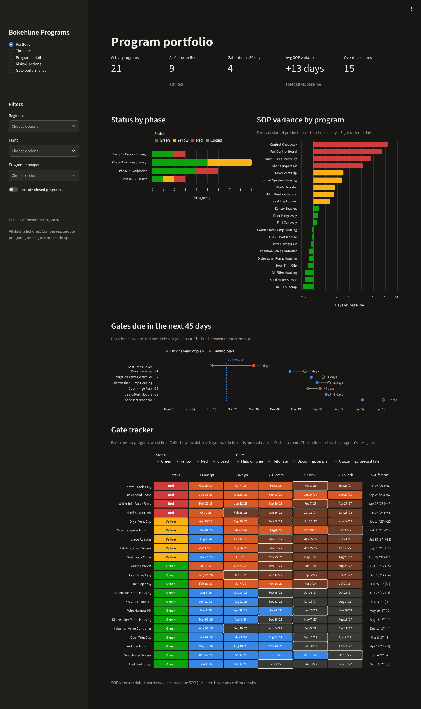
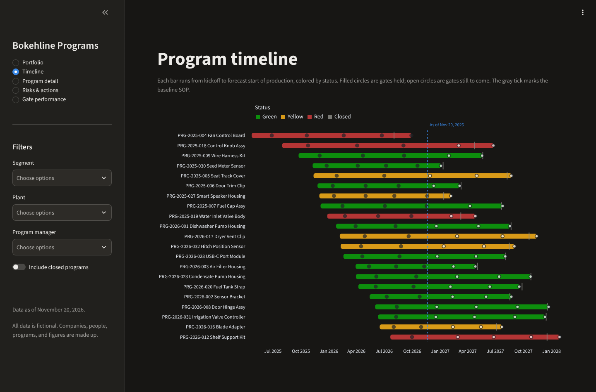
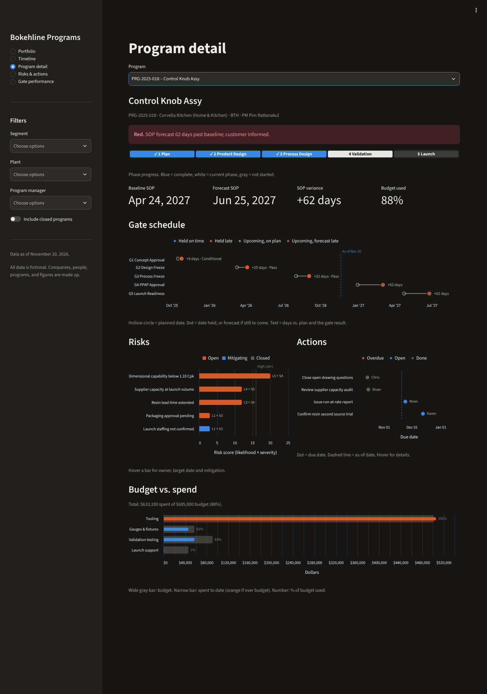
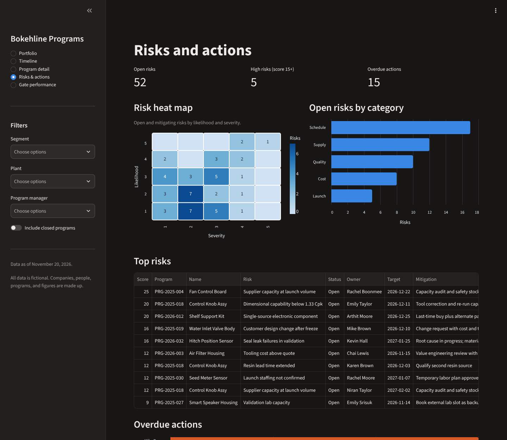
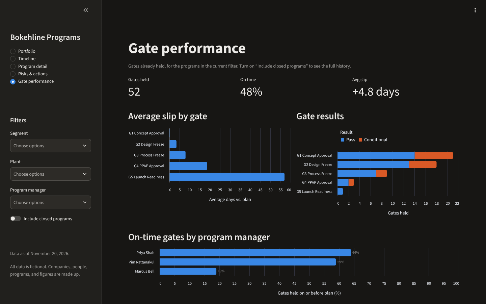

# Bokehline Programs

A program management dashboard for a portfolio of new-product launches. It shows status, schedule, gate reviews, risks, actions and budget, built with Python, Streamlit and SQLite.

- **Live demo:** https://bokehline-programs.streamlit.app
- **Companion project:** [Bokehline Ops](https://github.com/Bokehline-Technologies/bokehline-ops), the plant operations dashboard and data-entry app

> All data is fictional. Bokehline Technologies is the author's own company name. The customers, people, programs and figures were made up for this demo.



## What it does

The dashboard covers 32 launch programs across three plants. Each program follows a five-gate APQP-style process (G1 Concept Approval → G5 Launch Readiness). The data is frozen at **November 20, 2026**, so every view describes the same point in time.

| Page | What it answers |
|---|---|
| **Portfolio** | How many programs are at risk? Which ones are slipping, and which gates are due soon? |
| **Timeline** | When does each program start and launch? How far has its forecast moved from the baseline? |
| **Program detail** | One program's status, gates, risks, actions and budget vs. spend |
| **Risks & actions** | Where risks cluster (5×5 heat map), the top open risks, and who owns overdue actions |
| **Gate performance** | How often gates happen on time, and how much each gate slips |

Sidebar filters (segment, plant, program manager, and whether to include closed programs) apply to every page.

### Status rules

Status is calculated from the data, not typed in by hand:

- **Red**: forecast SOP is more than 30 days late, or a high risk (score 16 or more) is open on a program more than 21 days late
- **Yellow**: more than 7 days late, or a high risk is open
- **Green**: everything else
- **Closed**: launched at least 90 days ago

Risk score = likelihood × severity (each 1–5).

## Screenshots

| | |
|---|---|
|  |  |
|  |  |

## Data model

`bokehline_programs.db` is a SQLite file with eight tables plus a `meta` table that holds the as-of date.

```
plants ──┐
customers ──┼──< programs >── employees (program manager)
            │       │
            │       ├──< gate_reviews   (5 per program: planned, forecast, actual, result)
            │       ├──< risks          (likelihood, severity, status, owner, mitigation)
            │       ├──< actions        (owner, due, completed)
            │       └──< budget_lines   (tooling, gauges, validation, launch support)
```

| Table | Rows | Notes |
|---|---|---|
| programs | 32 | phase, status, kickoff, SOP baseline / forecast / actual |
| gate_reviews | 160 | an open gate has a forecast date but no actual date |
| risks | 86 | Open, Mitigating or Closed |
| actions | 105 | overdue = not completed and due before the as-of date |
| budget_lines | 128 | four lines per program |
| customers / employees / plants | 19 / 60 / 3 | segments: Mobility, Home & Kitchen, Outdoor Power, HVAC, Consumer Electronics, Agriculture |

Sample queries for each dashboard view are in [`sql/practice-queries.sql`](sql/practice-queries.sql).

## Run it locally

You need Python 3.10 or newer.

```bash
git clone https://github.com/Bokehline-Technologies/bokehline-programs.git
cd bokehline-programs
python3 -m pip install -r requirements.txt
python3 -m streamlit run app.py
```

The app opens at http://localhost:8501. It opens the database read-only, so nothing you do in the app changes the file.

## Built with

Python · Streamlit · SQLite · pandas · Altair

Built while learning SQL, using an AI coding assistant as a tutor and pair programmer.

## License

MIT © 2026 Bokehline Technologies LLC. See [LICENSE](LICENSE).
